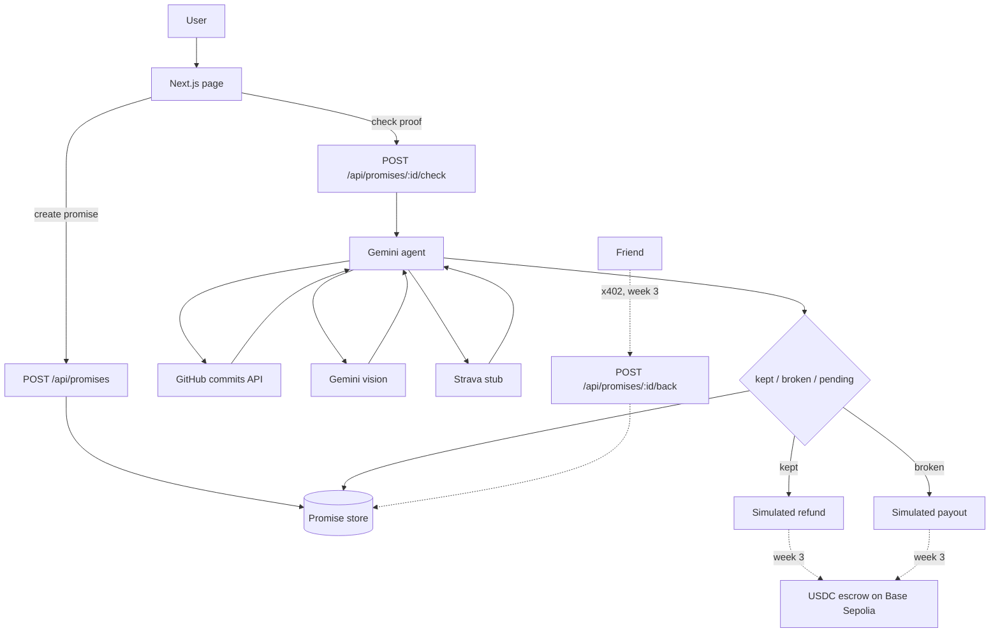

# Proof of Promise

Stake USDC on a personal promise. An agent checks your proof (GitHub, photo, Strava) and decides whether you keep the stake or forfeit it to a friend or charity.

Week 2 hackathon build for Rise In Agentmaxxing. Settlement is simulated on Base Sepolia — no real transfers. Friend stake-backing via x402 is stubbed for week 3.

## How it works



You write a promise (what, deadline, proof, stake, and who receives it if you break it). The list starts empty. **Try an example** only fills the form.

**Check proof** asks Gemini to call the matching tool, read the result, and record the verdict. GitHub reads the live commits API for the repository and date window you entered. A photo is sent to Gemini vision. Strava is not connected, so that tool reports it cannot verify and the stake stays unsettled. If `GEMINI_API_KEY` is missing or Gemini errors, the page shows the error and nothing is settled.

`kept` and `broken` call `settleStake()` in `agent/wallet.ts` with `mocked: true` and no `txHash`. The page labels that settlement simulated.

Promises live in `data/promises.json` locally, or under `/tmp` on Vercel (ephemeral). Cold starts can wipe them. The app does not seed sample promises.

## Setup

Node 20+.

```bash
cp .env.example .env
npm install
npm run dev
```

[http://localhost:3000](http://localhost:3000) — `npm run build` / `npm start` for production.

## Environment variables

| Variable | Required | Notes |
| --- | --- | --- |
| `GEMINI_API_KEY` | Yes, for every check | [Google AI Studio](https://aistudio.google.com/apikey) |
| `GEMINI_MODEL` | No | Default `gemini-3.6-flash` (tool calling and images) |
| `GITHUB_TOKEN` | No | Public commits only; helps rate limits |
| `WALLET_PRIVATE_KEY` | No | Week 3. Week 2 settlement does not sign or broadcast |

Do not commit `.env`, `.agent-wallet.json`, or `data/`.

## Deploy

Import on [Vercel](https://vercel.com/new) and set `GEMINI_API_KEY`. API routes use the Node.js runtime. The check route allows 180 seconds. Photo uploads are limited to 4 MB, under the 4.5 MB serverless body limit.

**Live demo:** https://proof-of-promise.vercel.app

## Using it

1. Make a promise. Pick GitHub, a photo, or Strava. Each type has a short note about what the check actually does.
2. The promise shows up in the list with a status.
3. **Check proof** runs the agent and shows the tools it called, the evidence, the verdict, and the simulated settlement.

Past deadlines are allowed, so a GitHub window that already ended can be checked.

## Roadmap (week 3)

- Escrow on Base Sepolia: lock USDC on create, refund the maker on kept, pay the beneficiary on broken.
- Real `StakeSettler` + `txHash` on receipts.
- `POST /api/promises/:id/back` returns 402; friends pay with `payAndFetch`.
- Strava OAuth behind `agent/proofs/strava.ts`.
- Redis or Blob instead of `/tmp`.

MIT
