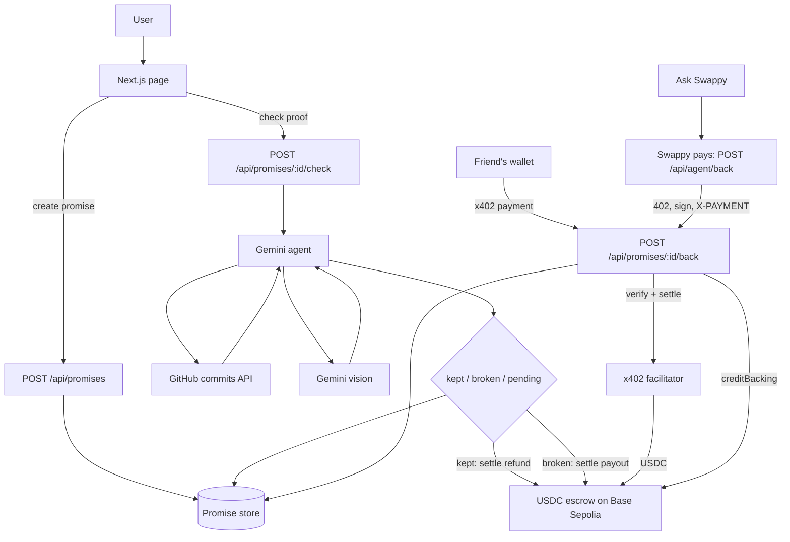

<p align="center"></p>

# Proof of Promise

**Put money on your promises.** Swappy is the AI agent that checks your proof and settles the stake.

Stake USDC on a personal promise. Swappy checks your proof (GitHub commits or a photo, including workout screenshots from any fitness app) and decides whether you get the stake back or it goes to a friend or charity.

**Live:** https://proof-of-promise.vercel.app · **Week 2 demo:** [YouTube](https://youtu.be/mULHLHCVfV4)  · **Week 3 demo:** [YouTube](https://youtu.be/_TlOQUOXvm8)

## The problem

Everyone says "I'll ship it this week" or "I'll start running." Nothing happens when we don't. Telling friends doesn't stick, and asking a friend to judge is awkward. Proof of Promise puts money on the line and lets Swappy be the neutral judge: it reads the real evidence and settles the stake.

Built for Rise In Agentmaxxing. Everything runs on Base Sepolia testnet. Stakes are real testnet USDC in an escrow contract. Promises are backed with x402 payments that land in the same escrow, either from your own wallet or paid by Swappy itself.

## Key features

- Make a promise with a deadline, a stake, a proof type, and who gets the money if you break it
- GitHub promises are decided by a plain commit count from the GitHub API, with no model call
- Photo promises: a Gemini agent calls the proof tool, reads the evidence and records `kept`, `broken` or `pending`
- Live GitHub commit checks for a repo, author and date window
- Photo proof checked with Gemini vision. Photos are shrunk in the browser to under 650 KB before upload
- Promises and photos saved in Upstash Redis, so they survive redeploys
- Full trace on every card: tools called, evidence, verdict, settlement
- Never slashes an unverified stake. Failed checks stay `pending`
- Clear errors when Gemini is missing or busy (45s timeout per call, one retry)

## Week 2

- **Ask Swappy:** one text box at the top. Type "send 1 USDC to 0x...", "I promise to push 3 commits by Friday, stake 1 USDC" or "back the running promise with 0.5 USDC" and Swappy turns it into a send, a prefilled promise form, or a backing
- **Natural-language sends:** you always see a review card first. Small sends (up to 2 USDC or 0.001 ETH) can go from the agent wallet; anything bigger goes from your own wallet. Agent sends are rate-limited per IP and per day
- **Real escrow:** stakes are locked in the escrow contract on Base Sepolia (`0x0cb3d1093AeD5E812f2f4Fd1a3cF92f93868782d`). Funding uses one batched call, a USDC permit, or approve + create, depending on the wallet
- **Backing from a wallet:** friends can add USDC to an open promise, and it is credited after the transfer is checked on chain
- **x402 backing:** `POST /api/promises/:id/back?amount=0.5` answers 402 with the price. The friend signs a USDC authorization (no gas), the x402.org facilitator moves it into the escrow, and Swappy calls `creditBacking` so refunds and payouts include it. The card has a "Back with USDC" button for this
- **Chain-state reads:** stake, backing and status on each card come from the escrow, not the database. If the RPC is down it falls back to the saved copy
- **Expire and refund:** if nobody settles a promise by the deadline plus the grace period, anyone can expire it and the stake and backings go back to whoever put them in
- Wallet errors in plain words (wrong network, rejected, not enough USDC)
- **Workout screenshots:** photo proof also works for a screenshot from any fitness app. Gemini vision reads the distance and date

## Week 3: x402

Swappy is on both sides of x402. It runs the paid resource (`POST /api/promises/:id/back`) and it is also an x402 client that can pay that resource from its own wallet when you ask it to.

**Swappy pays (Ask Swappy)**

1. You type "back <promise> with 0.1 USDC" in Ask Swappy and press Confirm on the review card. "Swappy pays via x402" is picked by default.
2. The server (`POST /api/agent/back`, `agent/x402-pay.ts`) calls `/back?amount=0.1` with no payment and gets `402 Payment Required` with the price: exact scheme, `base-sepolia`, USDC, `payTo` = the escrow.
3. Swappy checks the quote before signing anything. Wrong token, network, amount or recipient and it stops. It pays at most 2 USDC per backing and shares the agent wallet's rate limit (3 per hour per IP, 10 per day).
4. It signs an EIP-3009 `transferWithAuthorization` with the agent key and retries the request with the `X-PAYMENT` header.
5. The endpoint verifies the payment with the facilitator, then asks it to settle. The facilitator submits the USDC transfer on Base Sepolia and pays the gas.
6. Swappy calls `creditBacking` on the escrow so the backing counts toward the refund or payout.
7. The steps stream back to the page as they happen (402, signed, settling, settled). The result shows the x402 payment tx and the credit tx, both linking to BaseScan.

**Why Swappy pays**

Swappy pays on the backer's behalf from a capped agent budget (2 USDC per backing). In this testnet demo that budget is Swappy's own test USDC, so Swappy is recorded as the backer and refunds go back to that budget. In production the backer would top up their budget first, and refunds would go back to them. If you'd rather pay directly, use the "Back with USDC" button. That's x402 too, signed from your own wallet.

Example:

1. A friend tops up their Swappy budget with 5 USDC.
2. They ask Swappy to back your promise with 1 USDC.
3. Swappy pays the 1 USDC over x402 from that budget, and the escrow records the friend as the backer.
4. You keep the promise, so the 1 USDC goes back to the friend.
5. If you break it, the 1 USDC goes to them as the payout instead.

**You pay (your wallet)**

Same flow, but the browser does steps 2 to 4 and your wallet signs the authorization (no gas). Use the "Back with USDC" button on a promise page, or pick "Your wallet via x402" in Ask Swappy.

Each backing on the promise page has two links: **x402 payment** (the facilitator's settlement) and **Credited by Swappy** (the `creditBacking` call).

The public x402.org facilitator sends a lot of transactions from one key and sometimes trips on its own nonce. Swappy retries settle a few times in that case only. The EIP-3009 nonce means a retry can never charge twice.

## How it works




You write a promise (what, deadline, proof, stake, and who receives it if you break it). The list starts empty. **Try an example** only fills the form.

**Check proof** for a GitHub promise counts commits on the repository between creation and the deadline straight from the GitHub API, and decides `kept` (count reaches the target) or `broken` (deadline passed without it). No model is involved, so a Gemini outage or quota can't block it. For a photo promise, Gemini calls the matching tool, reads the result, and records the verdict. A photo (or a workout screenshot from any fitness app) is sent to Gemini vision, which also reads distance and date. If `GEMINI_API_KEY` is missing or Gemini errors, the page shows the error and nothing is settled.

`kept` and `broken` call `settleStake()` in `agent/wallet.ts`. For promises staked in the escrow it sends `settle` on chain: the stake and backings go back to the maker and backers if kept, or to the friend if broken, and the tx shows on the promise page. Only old promises made before the escrow existed settle as simulated.

Promises are stored in Upstash Redis when its env vars are set, photos included (up to 700 KB each). Without Redis they go to `data/promises.json` locally, or `/tmp` on Vercel, where cold starts wipe them. `GET /api/promises` reports which one is in use as `meta.storage`. The app does not seed sample promises.


## Agent tools

From `agent/tools.ts`:

| Tool | What it does |
| --- | --- |
| `check_github_commits` | Counts public commits on the promise's repo, author and date window via the GitHub API |
| `check_image_proof` | Sends the uploaded photo to Gemini vision and returns whether it shows the claim. Works for workout screenshots too |
| `record_verdict` | Saves the final verdict (`kept`, `broken`, `pending`) with a short explanation citing the evidence |

Settlement (`settleStake` in `agent/wallet.ts`) runs after the verdict, outside the model. For promises staked in the escrow it calls `settle` on chain; older promises without an escrow stake are settled as simulated.

Ask Swappy (`POST /api/ask`, `lib/intent.ts`, `lib/transfer.ts`) adds:

| Tool | What it does |
| --- | --- |
| Create promise | Reads "I promise to..." and fills the promise form. You review and fund it from your wallet |
| Back promise | Finds the promise you mean by id or title and backs it over x402, paid by Swappy or by your wallet |
| x402 resource (`/back`) | `lib/x402.ts` builds the 402 price, checks the `X-PAYMENT` header, and verifies/settles it through the facilitator before `creditBacking` |
| x402 agent payment (new) | `agent/x402-pay.ts` + `POST /api/agent/back`: Swappy requests `/back`, reads the 402, checks the quote, signs EIP-3009 with the agent wallet and retries with `X-PAYMENT`. Capped at 2 USDC, rate-limited, streams each step |
| x402 wallet payment | `backWithX402` in `lib/fund.ts`: same flow, signed by your browser wallet |
| Settle retry (new) | `settleWithRetry` in `lib/x402.ts`: retries settle only when the facilitator clashes on its own nonce |
| Send tokens | Parses "send 1 USDC to 0x..." into a transfer. Agent wallet sends are capped at 2 USDC (0.001 ETH) per transfer and need a Confirm click |
| Chain-state read | `lib/chain-state.ts` reads `getPromise` and the grace period from the escrow for every promise |
| Expire and refund | Calls `expire` on the escrow after deadline + grace, returning the stake to the maker and backers |

## AI models

| Use | Model |
| --- | --- |
| Agent (tool calling) | `gemini-3.6-flash` (default) |
| Photo checks (vision) | Same model, `gemini-3.6-flash` |
| Override | Set `GEMINI_MODEL` to any Gemini model that supports function calling and image input |
| Fallback | `gemini-3.8-flash` (set via `GEMINI_FALLBACK_MODEL` in production). Only used when `gemini-3.6-flash` hits its daily quota |
| GitHub checks | No model. The verdict comes from the commit count |

## Tech stack

| | Version |
| --- | --- |
| Next.js (App Router, Turbopack) | 16.4.2 |
| React | 19.3.0 |
| TypeScript | 5.9.3 |
| Tailwind CSS | 4.3.3 |
| Google Gen AI SDK (`@google/genai`) | 2.28.0 |
| viem (Base Sepolia escrow, wallet, transfers) | 2.57.4 |
| x402 | v1, `exact` scheme, own implementation in `lib/x402.ts` (no SDK) |
| x402 facilitator | x402.org (Base Sepolia) |
| Upstash Redis (REST API via `fetch`, no SDK) | n/a |
| Node.js | 20+ |
| Hosting | Vercel (Node.js runtime) |

## Setup

Node 20+.

```bash
cp .env.example .env
npm install
npm run dev
```

[http://localhost:3000](http://localhost:3000) — `npm run build` / `npm start` for production.

## Environment variables

| Variable | Required | Notes |
| --- | --- | --- |
| `GEMINI_API_KEY` | Yes, for photo checks and Ask Swappy | [Google AI Studio](https://aistudio.google.com/apikey) |
| `GEMINI_MODEL` | No | Default `gemini-3.6-flash` (tool calling and images) |
| `GEMINI_FALLBACK_MODEL` | No | Second Gemini model, used when the first one's daily quota is used up |
| `GITHUB_TOKEN` | No | Public commits only; helps rate limits |
| `KV_REST_API_URL` / `KV_REST_API_TOKEN` | No | Upstash Redis REST (set by the Vercel Marketplace integration). `UPSTASH_REDIS_REST_URL` / `UPSTASH_REDIS_REST_TOKEN` also work. Without them promises go to a local file |
| `WALLET_PRIVATE_KEY` | No | Agent wallet on Base Sepolia. Settles escrow stakes, credits backings and sends small transfers. Testnet only |
| `X402_FACILITATOR_URL` | No | Default `https://x402.org/facilitator` (free, Base Sepolia) |
| `X402_SELF_ORIGIN` | No | Base URL Swappy pays when it backs a promise. Defaults to the request's own origin |

Do not commit `.env`, `.agent-wallet.json`, or `data/`.

## Deploy

Import on [Vercel](https://vercel.com/new) and set `GEMINI_API_KEY`. API routes use the Node.js runtime. Photo uploads are limited to 4 MB, under the 4.5 MB serverless body limit.

## Using it

1. Make a promise. Pick GitHub or a photo (a workout screenshot works too).
2. It shows up in the list with a status.
3. Back it: ask Swappy ("back <promise> with 0.1 USDC") and Swappy pays over x402, or use "Back with USDC" to pay from your wallet.
4. **Check proof** runs the agent and shows the tools it called, the evidence, the verdict, and the settlement tx.

Past deadlines are allowed, so a GitHub window that already ended can be checked.

## Demo links

Week 1 (proofofpromise.v1): not submitted (joined at Week 2)  
Week 2 (proofofpromise.v2): https://youtu.be/mULHLHCVfV4  
Week 3 (proofofpromise.v3): https://youtu.be/_TlOQUOXvm8

Live: https://proof-of-promise.vercel.app

## Future scope

- x402 v2 and more facilitators, so a busy public facilitator isn't a single point of failure
- More chains the facilitators already support (Base mainnet after an audit, Polygon Amoy, Avalanche Fuji)
- Let other agents back promises through the same x402 endpoint, with a small public spec
- Deadline reminders by email before a promise closes
- Group promises, where a few friends stake on the same goal
- Backer-funded agent budgets (top up Swappy, refunds go back to you)
- Mainnet once the escrow is audited

## Social

X: [@swappy_ai](https://x.com/swappy_ai) · Built for [@riseinweb3](https://x.com/riseinweb3)

## License

MIT
