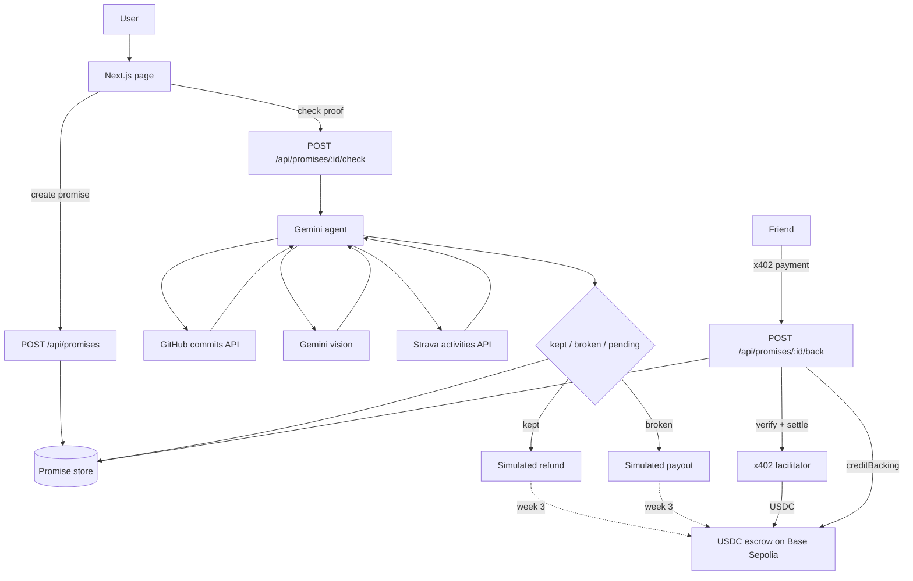

<p align="center"></p>

# Proof of Promise

**Put money on your promises.** Swappy is the AI agent that checks your proof and settles the stake.

Stake USDC on a personal promise. Swappy checks your proof (GitHub, photo, Strava) and decides whether you get the stake back or it goes to a friend or charity.

**Live:** https://proof-of-promise.vercel.app · **Week 2 demo:** [YouTube](https://youtu.be/mULHLHCVfV4)

## The problem

Everyone says "I'll ship it this week" or "I'll start running." Nothing happens when we don't. Telling friends doesn't stick, and asking a friend to judge is awkward. Proof of Promise puts money on the line and lets Swappy be the neutral judge: it reads the real evidence and settles the stake.

Built for Rise In Agentmaxxing. Everything runs on Base Sepolia testnet. Stakes are real testnet USDC in an escrow contract. Friends back promises with x402 payments that land in the same escrow.

## Key features

- Make a promise with a deadline, a stake, a proof type, and who gets the money if you break it
- Gemini agent calls a proof tool, reads the evidence and records `kept`, `broken` or `pending`
- Live GitHub commit checks for a repo, author and date window
- Photo proof checked with Gemini vision. Photos are shrunk in the browser to under 650 KB before upload
- Promises and photos saved in Upstash Redis, so they survive redeploys
- Full trace on every card: tools called, evidence, verdict, settlement
- Never slashes an unverified stake. Failed checks stay `pending`
- Clear errors when Gemini is missing or busy (45s timeout per call, one retry)

## Week 2

- **Ask Swappy:** one text box at the top. Type "send 1 USDC to 0x...", "I promise to push 3 commits by Friday, stake 1 USDC" or "back the running promise with 0.5 USDC" and Swappy turns it into a send, a prefilled promise form, or a backing
- **Natural-language sends:** you always see a review card first. Small sends (up to 2 USDC or 0.001 ETH) can go from the agent wallet; anything bigger goes from your own wallet. Agent sends are rate-limited per IP and per day
- **Real escrow:** stakes are locked in the escrow contract on Base Sepolia (`0x0cb3d1093AeD5E812f2f4Fd1a3cF92f93868782d`). Funding uses one batched call, a USDC permit, or approve + create, depending on the wallet
- **Backing from a wallet:** friends can add USDC to an open promise, and it is credited after the transfer is checked on chain
- **x402 backing:** `POST /api/promises/:id/back?amount=0.5` answers 402 with the price. The friend signs a USDC authorization (no gas), the x402.org facilitator moves it into the escrow, and Swappy calls `creditBacking` so refunds and payouts include it. The card has a "Back with USDC" button for this
- **Chain-state reads:** stake, backing and status on each card come from the escrow, not the database. If the RPC is down it falls back to the saved copy
- **Expire and refund:** if nobody settles a promise by the deadline plus the grace period, anyone can expire it and the stake and backings go back to whoever put them in
- Wallet errors in plain words (wrong network, rejected, not enough USDC)
- **Strava proof:** "Connect Strava" on a Strava promise card (scope `activity:read_all`). Tokens are kept per promise in Redis and refreshed when they expire. The check counts activities of the right type and distance between creation and the deadline

## How it works




You write a promise (what, deadline, proof, stake, and who receives it if you break it). The list starts empty. **Try an example** only fills the form.

**Check proof** asks Gemini to call the matching tool, read the result, and record the verdict. GitHub reads the live commits API for the repository and date window you entered. A photo is sent to Gemini vision. Strava reads your activities between when the promise was made and the deadline, after you connect Strava on the card. If Strava isn't connected or configured, the check stays `pending` and nothing is settled. If `GEMINI_API_KEY` is missing or Gemini errors, the page shows the error and nothing is settled.

`kept` and `broken` call `settleStake()` in `agent/wallet.ts` with `mocked: true` and no `txHash`. The page labels that settlement simulated.

Promises are stored in Upstash Redis when its env vars are set, photos included (up to 700 KB each). Without Redis they go to `data/promises.json` locally, or `/tmp` on Vercel, where cold starts wipe them. `GET /api/promises` reports which one is in use as `meta.storage`. The app does not seed sample promises.


## Agent tools

From `agent/tools.ts`:

| Tool | What it does |
| --- | --- |
| `check_github_commits` | Counts public commits on the promise's repo, author and date window via the GitHub API |
| `check_image_proof` | Sends the uploaded photo to Gemini vision and returns whether it shows the claim |
| `check_strava_activity` | Reads your Strava activities in the promise window and counts the ones that match the type, distance and number of times |
| `record_verdict` | Saves the final verdict (`kept`, `broken`, `pending`) with a short explanation citing the evidence |

Settlement (`settleStake` in `agent/wallet.ts`) runs after the verdict, outside the model. For promises staked in the escrow it calls `settle` on chain; older promises without an escrow stake are settled as simulated.

Ask Swappy (`POST /api/ask`, `lib/intent.ts`, `lib/transfer.ts`) adds:

| Tool | What it does |
| --- | --- |
| Create promise | Reads "I promise to..." and fills the promise form. You review and fund it from your wallet |
| Back promise | Finds the promise you mean by id or title and backs it with USDC from your wallet |
| x402 backing | `lib/x402.ts` builds the 402 price, signs the EIP-3009 payment in the browser, and verifies/settles it through the facilitator before `creditBacking` |
| Send tokens | Parses "send 1 USDC to 0x..." into a transfer. Agent wallet sends are capped at 2 USDC (0.001 ETH) per transfer and need a Confirm click |
| Chain-state read | `lib/chain-state.ts` reads `getPromise` and the grace period from the escrow for every promise |
| Expire and refund | Calls `expire` on the escrow after deadline + grace, returning the stake to the maker and backers |

## AI models

| Use | Model |
| --- | --- |
| Agent (tool calling) | `gemini-3.6-flash` (default) |
| Photo checks (vision) | Same model, `gemini-3.6-flash` |
| Override | Set `GEMINI_MODEL` to any Gemini model that supports function calling and image input, e.g. `gemini-3.8-flash` or `gemini-3.5-flash-lite` |

## Tech stack

| | Version |
| --- | --- |
| Next.js (App Router, Turbopack) | 16.4.0 |
| React | 19.3.0 |
| TypeScript | 5.9.3 |
| Tailwind CSS | 4.3.3 |
| Google Gen AI SDK (`@google/genai`) | 2.28.0 |
| viem (Base Sepolia escrow, wallet, transfers) | 2.57.4 |
| Upstash Redis (REST API via `fetch`, no SDK) | n/a |
| Node.js | 20+ |
| Hosting | Vercel (Node.js runtime) |

## Setup

Node 20+.

```bash
cp .env.example .env
npm install
npm run dev
```

[http://localhost:3000](http://localhost:3000) — `npm run build` / `npm start` for production.

## Environment variables

| Variable | Required | Notes |
| --- | --- | --- |
| `GEMINI_API_KEY` | Yes, for every check | [Google AI Studio](https://aistudio.google.com/apikey) |
| `GEMINI_MODEL` | No | Default `gemini-3.6-flash` (tool calling and images) |
| `GITHUB_TOKEN` | No | Public commits only; helps rate limits |
| `KV_REST_API_URL` / `KV_REST_API_TOKEN` | No | Upstash Redis REST (set by the Vercel Marketplace integration). `UPSTASH_REDIS_REST_URL` / `UPSTASH_REDIS_REST_TOKEN` also work. Without them promises go to a local file |
| `WALLET_PRIVATE_KEY` | No | Agent wallet on Base Sepolia. Settles escrow stakes, credits backings and sends small transfers. Testnet only |
| `STRAVA_CLIENT_ID` / `STRAVA_CLIENT_SECRET` | No | From your [Strava API app](https://www.strava.com/settings/api). Set the Authorization Callback Domain to your site's domain. Needs Redis. Without them the card says Strava isn't configured |
| `X402_FACILITATOR_URL` | No | Default `https://x402.org/facilitator` (free, Base Sepolia) |

Do not commit `.env`, `.agent-wallet.json`, or `data/`.

## Deploy

Import on [Vercel](https://vercel.com/new) and set `GEMINI_API_KEY`. API routes use the Node.js runtime. Photo uploads are limited to 4 MB, under the 4.5 MB serverless body limit.

## Using it

1. Make a promise. Pick GitHub, a photo, or Strava.
2. It shows up in the list with a status.
3. **Check proof** runs the agent and shows the tools it called, the evidence, the verdict, and the simulated settlement.

Past deadlines are allowed, so a GitHub window that already ended can be checked.

## Demo links

Week 2 (proofofpromise.v2): https://youtu.be/mULHLHCVfV4  
Week 3 (proofofpromise.v3): TODO

Live: https://proof-of-promise.vercel.app

## Future scope

- More activity sources (Apple Health, Garmin)
- Mainnet once the escrow is audited
- Group promises, where a few friends stake on the same goal

## Social

X: [@swappy_ai](https://x.com/swappy_ai) · Built for [@riseinweb3](https://x.com/riseinweb3)

## License

MIT
