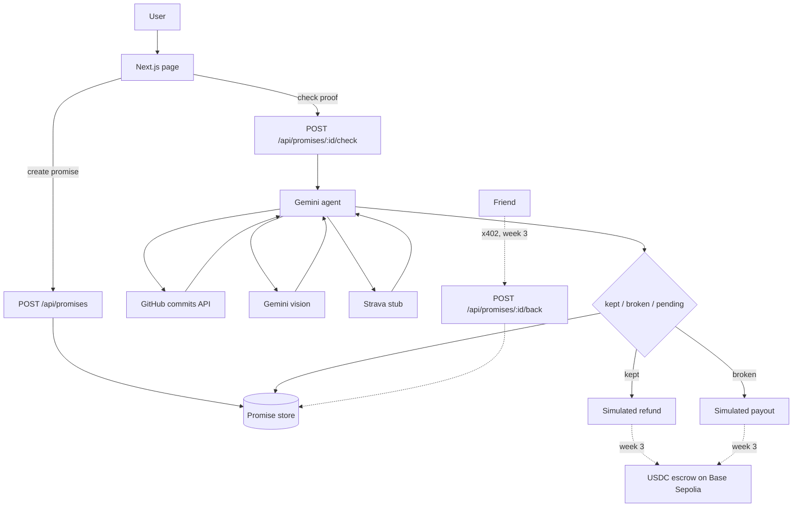

<p align="center"></p>

# Proof of Promise

Stake USDC on a personal promise. An agent checks your proof (GitHub, photo, Strava) and decides whether you get the stake back or it goes to a friend or charity.

**Live:** https://proof-of-promise.vercel.app · **Demo video:** [YouTube](https://youtu.be/WDhPanZ4RVA)

## The problem

Everyone says "I'll ship it this week" or "I'll start running." Nothing happens when we don't. Telling friends doesn't stick, and asking a friend to judge is awkward. Proof of Promise puts money on the line and lets an agent be the neutral judge: it reads the real evidence and settles the stake.

Built for Rise In Agentmaxxing. Week 2: settlement is simulated (no real transfers), and friend backing via x402 is stubbed.

## Key features

- Make a promise with a deadline, a stake, a proof type, and who gets the money if you break it
- Gemini agent calls a proof tool, reads the evidence and records `kept`, `broken` or `pending`
- Live GitHub commit checks for a repo, author and date window
- Photo proof checked with Gemini vision
- Full trace on every card: tools called, evidence, verdict, settlement
- Never slashes an unverified stake. Failed checks stay `pending`
- Clear errors when Gemini is missing or busy (45s timeout per call, one retry)

## How it works




You write a promise (what, deadline, proof, stake, and who receives it if you break it). The list starts empty. **Try an example** only fills the form.

**Check proof** asks Gemini to call the matching tool, read the result, and record the verdict. GitHub reads the live commits API for the repository and date window you entered. A photo is sent to Gemini vision. Strava is not connected, so that tool reports it cannot verify and the stake stays unsettled. If `GEMINI_API_KEY` is missing or Gemini errors, the page shows the error and nothing is settled.

`kept` and `broken` call `settleStake()` in `agent/wallet.ts` with `mocked: true` and no `txHash`. The page labels that settlement simulated.

Promises live in `data/promises.json` locally, or under `/tmp` on Vercel (ephemeral). Cold starts can wipe them. The app does not seed sample promises.


## Agent tools

From `agent/tools.ts`:

| Tool | What it does |
| --- | --- |
| `check_github_commits` | Counts public commits on the promise's repo, author and date window via the GitHub API |
| `check_image_proof` | Sends the uploaded photo to Gemini vision and returns whether it shows the claim |
| `check_strava_activity` | Strava check. Not connected yet, so it reports unverified and nothing settles |
| `record_verdict` | Saves the final verdict (`kept`, `broken`, `pending`) with a short explanation citing the evidence |

Settlement (`settleStake` in `agent/wallet.ts`) runs after the verdict, outside the model.

## AI models

| Use | Model |
| --- | --- |
| Agent (tool calling) | `gemini-3.6-flash` (default) |
| Photo checks (vision) | Same model, `gemini-3.6-flash` |
| Override | Set `GEMINI_MODEL` to any Gemini model that supports function calling and image input, e.g. `gemini-3.8-flash` or `gemini-3.5-flash-lite` |

## Tech stack

| | Version |
| --- | --- |
| Next.js (App Router, Turbopack) | 16.4.0 |
| React | 19.3.0 |
| TypeScript | 5.9.3 |
| Tailwind CSS | 4.3.3 |
| Google Gen AI SDK (`@google/genai`) | 2.28.0 |
| viem (Base Sepolia, week 3 signing) | 2.57.4 |
| Node.js | 20+ |
| Hosting | Vercel (Node.js runtime) |

## Setup

Node 20+.

```bash
cp .env.example .env
npm install
npm run dev
```

[http://localhost:3000](http://localhost:3000) — `npm run build` / `npm start` for production.

## Environment variables

| Variable | Required | Notes |
| --- | --- | --- |
| `GEMINI_API_KEY` | Yes, for every check | [Google AI Studio](https://aistudio.google.com/apikey) |
| `GEMINI_MODEL` | No | Default `gemini-3.6-flash` (tool calling and images) |
| `GITHUB_TOKEN` | No | Public commits only; helps rate limits |
| `WALLET_PRIVATE_KEY` | No | Week 3. Week 2 settlement does not sign or broadcast |

Do not commit `.env`, `.agent-wallet.json`, or `data/`.

## Deploy

Import on [Vercel](https://vercel.com/new) and set `GEMINI_API_KEY`. API routes use the Node.js runtime. Photo uploads are limited to 4 MB, under the 4.5 MB serverless body limit.

## Using it

1. Make a promise. Pick GitHub, a photo, or Strava.
2. It shows up in the list with a status.
3. **Check proof** runs the agent and shows the tools it called, the evidence, the verdict, and the simulated settlement.

Past deadlines are allowed, so a GitHub window that already ended can be checked.

## Demo links

Week 1 (proofofpromise.v1): n/a  
Week 2 (proofofpromise.v2): https://youtu.be/WDhPanZ4RVA  
Week 3 (proofofpromise.v3): coming soon

Live: https://proof-of-promise.vercel.app

## Future scope

- Real USDC escrow on Base Sepolia: lock on create, refund on kept, pay the beneficiary on broken
- x402 friend backing: friends pay to back a promise through `POST /api/promises/:id/back`
- Strava OAuth behind `agent/proofs/strava.ts`
- Persistent storage (Redis or Blob) instead of `/tmp`
- Auto-post results to X

## Social

X: coming soon

## License

MIT
